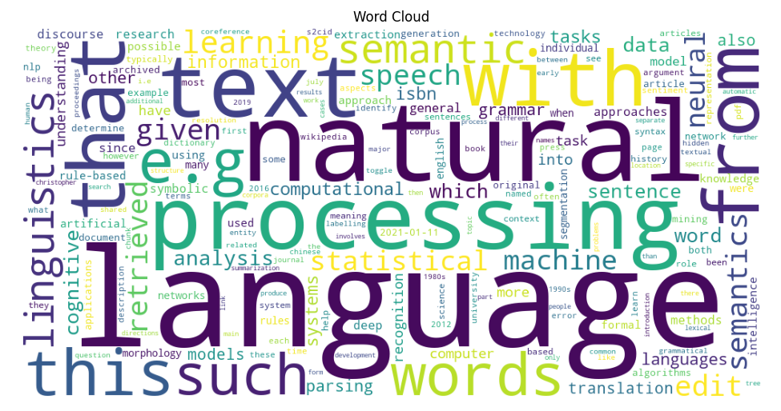

# nlp-02-text-preprocessing

[](pyproject.toml)
[](https://github.com/AbdelhafidhMahouel/nlp-02-text-preprocessing/actions/workflows/ci-python-zensical.yml)
[](https://abdelhafidhmahouel.github.io/nlp-02-text-preprocessing/)

[](https://docs.astral.sh/uv/)
[](https://docs.astral.sh/ty/)
[](https://zensical.org/)
[](LICENSE)

> Prepare raw text for natural language processing using Python.

## Project Overview

Author: Abdelhafidh Mahouel

Date: 2026 November

Second project in the Web Mining and Applied NLP course.

This project introduces text preprocessing,
an important foundation for natural language processing.

The goal is to read text data,
apply common preprocessing techniques,
compare raw and cleaned text,
and understand how preprocessing decisions affect analysis.

This custom project adapts Denise Case's example
to manufacturing continuous improvement.
It applies preprocessing to 16 production shift notes
and adjusts the cleaning rules for manufacturing text
to see how the most frequent tokens change.

The project is configured in
[pyproject.toml](pyproject.toml).

## Data

The example uses text records stored in
[data/text_data.txt](data/text_data.txt).

Each line represents one text record.

The project combines these records and applies
several preprocessing operations to prepare
the text for analysis.

The custom project uses
[data/production_log.txt](data/production_log.txt),
which contains 16 production shift notes
covering downtime, scrap, changeovers, maintenance, and kaizen ideas.
The entries are sample text written for this project with AI assistance
and reviewed by the author.
They do not come from a real plant.

## Approach

The project uses Python to clean and analyze text data.

The example demonstrates:

- Reading text records from a local file.
- Tokenizing text into individual words.
- Normalizing text through lowercasing.
- Removing punctuation and special characters.
- Filtering common stopwords.
- Comparing token counts before and after preprocessing.
- Computing token frequencies using Polars.
- Visualizing changes in token distributions with Matplotlib.

Explore these important project components:

- [pyproject.toml](pyproject.toml) - project identity, dependencies, and tool configuration.
- [data/](data/) - input text data.
- [src/nlp/text_preprocessing.py](src/nlp/text_preprocessing.py) - executable Python preprocessing analysis.
- [notebooks/text_preprocessing.ipynb](notebooks/text_preprocessing.ipynb) - interactive Jupyter notebook example.
- [notebooks/text_preprocessing_abdel.ipynb](notebooks/text_preprocessing_abdel.ipynb) - technical modification notebook (expanded stop word list).
- [notebooks/text_preprocessing_manufacturing.ipynb](notebooks/text_preprocessing_manufacturing.ipynb) - custom project notebook (manufacturing production log).
- [tests/](tests/) - automated tests.
- [.github/workflows/](.github/workflows/) - automated testing and documentation deployment.
- [docs/](docs/) - project documentation.
- [zensical.toml](zensical.toml) - documentation configuration.

The goal is to understand how raw text becomes
cleaned, structured data suitable for analysis.

## Run the Project

Follow the [Professional Python Workflow Guide](https://denisecase.github.io/pro-analytics-02/)
to set up your machine and project environment.

From a VS Code terminal in the project root:

```shell
uv run python -m nlp.text_preprocessing
```

**Close each visualization window** after viewing
so the script can continue executing.

The Jupyter notebook provides an additional
interactive version of the analysis.

## Results

The example loads text records,
applies preprocessing operations,
and produces token frequency summaries.

The analysis displays:

- Raw and cleaned token counts.
- A comparison of preprocessing stages.
- The most frequent cleaned tokens.
- Visualizations of token frequencies and counts.

Successful execution produces:

```shell
========================
Pipeline executed successfully!
========================
```

A `project.log` file is created in the project root.

This confirms that the Python analysis executes
and the logging system works.

### Example Visualization



## Technical Modification

The notebook
[notebooks/text_preprocessing_abdel.ipynb](notebooks/text_preprocessing_abdel.ipynb)
changes one preprocessing decision: the stop word list.

### What Changed

The original example removes 27 stop words.
The modified version adds 18 more common English function words,
such as *may*, *many*, *some*, *very*, *can*, and *this*,
for a total of 45 stop words.

Everything else stays the same
(data, lowercasing, punctuation removal, and minimum token length)
so the comparison is fair.

### Results

| Stage | Token Count |
| --- | --- |
| Raw tokens | 57 |
| After punctuation removal | 57 |
| After stop words (original list) | 46 |
| After stop words (modified list) | 41 |

The modification removed five additional tokens:
*into*, *many*, *may*, *some*, and *very*.

The most frequent tokens stayed the same:
*text* (5), *language* (3), *data* (2), and *words* (2).

### Interpretation

On this small dataset, expanding the stop word list has a modest effect
because the most frequent tokens are content words.
On a larger corpus, these function words would appear more often
and could crowd out meaningful words in the frequency results.

Every word added to a stop list is a decision.
Words such as *not* or *very* can carry meaning
in tasks like sentiment analysis,
so the right stop word list depends on the goal of the analysis.

## Custom Project: Manufacturing Continuous Improvement

The notebook
[notebooks/text_preprocessing_manufacturing.ipynb](notebooks/text_preprocessing_manufacturing.ipynb)
applies the preprocessing process to
[data/production_log.txt](data/production_log.txt).

### Analytical Question

Which equipment problems and improvement themes appear most often
in production shift notes,
and which preprocessing rules keep the manufacturing meaning intact?

### Cleaning Decisions

The example rules remove 27 stop words
and drop every token with 2 or fewer characters.
In manufacturing text, that silently removes
*PM*, *QC*, *5S*, *No*, and every number.

The custom rules make four deliberate decisions:

1. Keep short domain abbreviations: *PM*, *QC*, and *5S*.
2. Keep negations, such as *No defects* and *PM was not done*.
3. Remove context and filler words, such as
   *line*, *shift*, *station*, *week*, *because*, and *after*.
4. Set numbers aside as measurements instead of counting them as words.

### Results

| Stage | Token Count |
| --- | --- |
| Raw tokens | 220 |
| After punctuation removal | 221 |
| After example rules | 146 |
| After manufacturing rules | 130 |

Punctuation removal increased the count by one
because *Poka-yoke* split into two tokens.

With the example rules, filler and context words
such as *after*, *because*, and *line*
were among the most frequent tokens.

With the manufacturing rules, the most frequent tokens
describe what happened on the floor:
*changeover*, *stopped*, *dropped*, and *not* (3 each),
followed by *conveyor*, *belt*, *sensor*, *scrap*,
*missing*, *parts*, *root*, and *cause* (2 each).

The two-word phrases *root cause* and *conveyor belt*
each appear twice.

### Interpretation

Changeovers, conveyor jams, sensor faults, and scrap
are the recurring themes a continuous improvement team
would investigate first.

Generic cleaning rules removed meaningful domain information.
Keeping short abbreviations and negations,
removing context words,
and handling numbers and phrases separately
made the frequency results much more useful.

Some information is still lost or ambiguous:

- *pm* appears twice with two meanings:
  preventive maintenance and the clock time *2 pm*.
- Numbers such as *45 minutes*, *62% OEE*, and *6% scrap*
  hold key facts but are not counted as themes.

A next step would be to map abbreviations to full terms
and extract measurements with their units as structured data.

## Verification

Run the automated tests:

```shell
uv run python -m pytest
```

## Project Documentation

The [hosted documentation site](https://abdelhafidhmahouel.github.io/nlp-02-text-preprocessing/)
is published using Zensical and GitHub Pages.

The documentation site is used to present the project report,
covering such sections as data, methods, results, visualizations,
interpretation, and conclusions.

## CI/CD and GitHub Actions

This project includes continuous integration and continuous deployment (CI/CD)
to check project files and publish the docs.

GitHub Actions include:

- [CI: Python and Documentation Checks](https://github.com/AbdelhafidhMahouel/nlp-02-text-preprocessing/actions/workflows/ci-python-zensical.yml)
- [CD: Documentation Deployment](https://github.com/AbdelhafidhMahouel/nlp-02-text-preprocessing/actions/workflows/deploy-zensical.yml)

## Developer Reference

Follow the
[Professional Python Workflow Guide](https://denisecase.github.io/pro-analytics-02/)
for **detailed instructions and troubleshooting**.

### Initialize and Update the Python Environment

With the project open in VS Code, open a VS Code terminal.
Paste each command and hit Enter or Return after to run it.

```shell
uvx pup-clean --delete
uv self update
uv python pin 3.14
uv python install
uv lock --upgrade
uv sync
uv audit
```

### Set Up and Run Git Hooks

Set up and run the git hooks to perform
basic checks automatically before
any changes get pushed to GitHub.

In the VS Code terminal,
paste each command and hit Enter or Return after to run it.

```shell
uvx prek install --force
uvx prek update --freeze --cooldown-days 7

git add -A
uvx prek run --all-files
# repeat if changes were made
uvx prek run --all-files
```

### Run Common Chores

Run linters, formatters, type checks, tests, and
build the documentation.

```shell
uv run ruff check . --fix
uv run ruff format .

uv run ty check
uv run python -m pytest
uv run python -m zensical build
```

### Git add-commit-push to GitHub

After making useful changes, save your work to GitHub.

```shell
git add -A
git commit -m "describe your changes in quotes"
git push -u origin main
```

## Developer Notes

- Use the **UP ARROW** and **DOWN ARROW** in the terminal to scroll through past commands.
- Use `CTRL+f` to find (and replace) text within a file.

## Developer Tools

This project uses professional Python tools to support development,
testing, documentation, and code quality.

- [uv](https://docs.astral.sh/uv/) - Python environments and dependencies.
- [Ruff](https://docs.astral.sh/ruff/) - Python linting and formatting, configured in [.ruff.toml](.ruff.toml).
- [ty](https://docs.astral.sh/ty/) - Python type checking.
- [pytest](https://docs.pytest.org/) - automated Python testing, configured in [.pytest.toml](.pytest.toml).
- [prek](https://prek.j178.dev/) - Git hooks and automated checks, configured in [prek.toml](prek.toml).
- [Zensical](https://zensical.org/) - project documentation, configured in [zensical.toml](zensical.toml).

## Links

- [Hosted Documentation](https://abdelhafidhmahouel.github.io/nlp-02-text-preprocessing/)
- [Professional Python Workflow Guide](https://denisecase.github.io/pro-analytics-02/)
- [Citation](CITATION.cff)
- [License](LICENSE)
